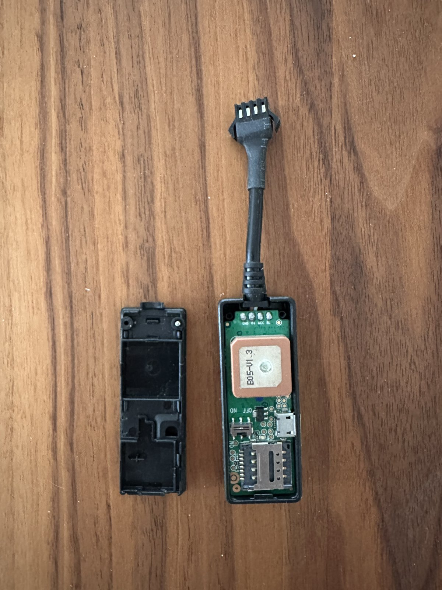
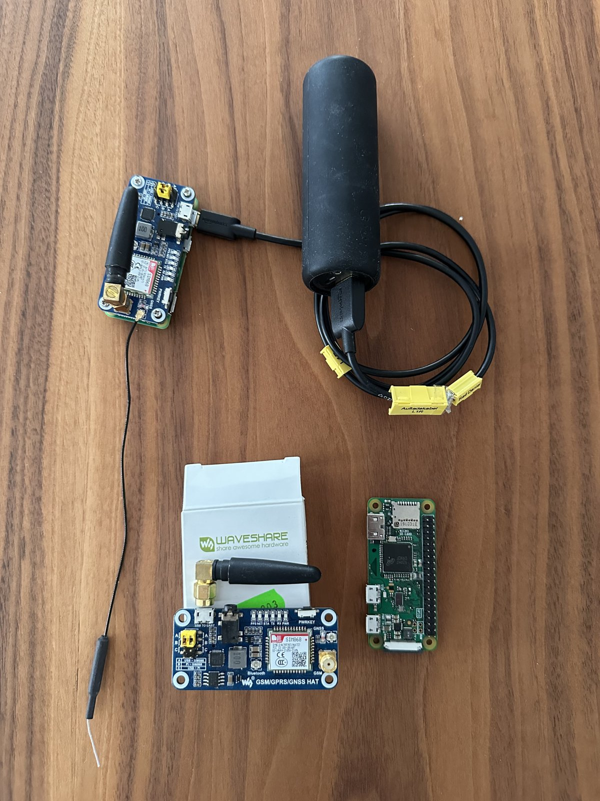
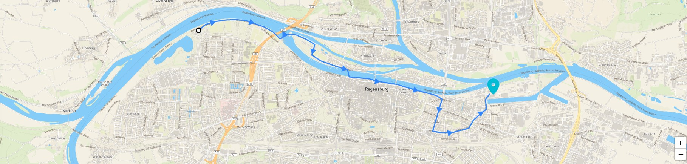

# Raspi GPS Tracker

GPS tracker based on a Raspberry Pi and a GSM/GPRS/GNSS HAT (SIM868). The tracker reads its position via GNSS, uploads it over the mobile network (GPRS) to the IoT platform [Ubidots](https://ubidots.com) and sends a daily status SMS with its last known location.

## Idea

I developed this GPS tracker as a theft protection for my bicycle. If the bike gets stolen, my Ubidots dashboard shows **when and where it was last seen**. Even if the thief finds and switches off the tracker, the last known position and its timestamp remain as a starting point for the search, and the daily status SMS shows that the tracker is still alive.

## Why a custom tracker?

Before this project I tried a commercial GPS tracker. It did not work reliably and needs a relatively large battery to run for a reasonable time. Building my own tracker on a Raspberry Pi with a SIM868 HAT gives full control over when positions are taken and uploaded, and the data ends up in my own Ubidots dashboard instead of a vendor cloud.



## Features

- **Positioning:** controls the GNSS module via AT commands (`AT+CGNS...`) and parses the NMEA sentences (`$GNRMC`, `$GNGGA`), including conversion to decimal degrees and local time.
- **Upload over mobile network:** coordinates are sent as HTTP POST directly through the GPRS module of the HAT to the Ubidots API, no WiFi or LAN needed.
- **Upload on movement only:** a new upload is triggered only when the position has changed (at most every 5 seconds).
- **Daily heartbeat:** once a day the tracker sends an SMS with its last known position.
- **Robust startup:** waits for the serial connection, powers on the board via the PWRKEY pin (GPIO 7) if needed and then runs in an endless loop with a dedicated GPS thread.
- **Case:** printable 3D models (STL) for the case and covers are located in `extra/3D Gehäuse/`.

## Hardware

| Component | Note |
|---|---|
| GSM/GPRS/GNSS HAT with SIM868 | connected via UART and GPIO 7 (PWRKEY), GSM and GNSS antenna |
| Raspberry Pi | tested with Raspberry Pi Zero W V1.1, UART has to be enabled |
| Power bank | goobay 5000 mAh |
| SIM card | Things Mobile IoT SIM (APN `TM`, set in `src/constants.py`) |



For first tests on a Windows PC, the CP210x USB driver and an AT command tester are included in `extra/`.

## Project structure

```
src/
  controller.py          entry point: connection setup, main loop, upload, SMS
  gps_module.py          GPS class: GNSS on/off, read and parse NMEA data
  uart_communication.py  serial communication with the HAT, AT commands and SMS
  ubi_api.py             upload of the position to Ubidots (via GPRS or requests)
  message.py             data container for latitude, longitude and timestamp
  gsm_pwrkey.py          powers on the board via GPIO
  constants.py           baud rates, port, AT commands, regex patterns, APN
docs/                    sphinx documentation
test/                    unit and integration tests
extra/                   drivers, tools, sample logs, 3D case
raspi/boot/              boot configuration for the Raspberry Pi (UART setup)
```

## Installation

### Raspberry Pi image

The tracker runs on Raspbian Buster (release 2020-02-13). After flashing the image, replace `config.txt` and `cmdline.txt` on the boot partition with the files from [`raspi/boot/`](raspi/boot). The relevant settings are:

```
enable_uart=1
dtoverlay=pi3-miniuart-bt
```

`enable_uart=1` enables the serial interface, and `pi3-miniuart-bt` moves Bluetooth to the mini UART, so the stable hardware UART `/dev/ttyAMA0` is free for the SIM868 HAT. The serial login console is removed from `cmdline.txt`.

### Python environment

```bash
git clone <repo-url>
cd raspi_gps_tracker
python3 -m venv venv
source venv/bin/activate
pip install pyserial python-dateutil requests RPi.GPIO
```

## Configuration

Before the first start, replace the placeholders with your own values:

| Setting | File |
|---|---|
| Ubidots token (`YOUR-UBIDOTS-TOKEN`) | `src/ubi_api.py`, `src/constants.py` (`SET_HTTP_USERDATA`) |
| Ubidots device label (`DEVICE_LABEL`) | `src/ubi_api.py` |
| Phone number for the daily SMS (`+49XXXXXXXXXX`) | `src/uart_communication.py` |
| `GPRS_APN`, `GPRS_LOGIN`, `GPRS_PASSWORD` | `src/constants.py` |
| `COMMON_PORT_NAME`: `/dev/ttyAMA0` (Pi 2B/Zero) or `/dev/ttyS0` (Pi 3B) | `src/constants.py` |

## Usage

```bash
cd src
python3 controller.py
```

After startup the logo is printed, then the tracker connects to the HAT, enables GNSS and GPRS and starts tracking. The positions show up in the Ubidots dashboard of the device:



## Development

The `Makefile` bundles the common tasks:

```bash
make pylint     # pylint with custom rules (pylint_modules/)
make pep8       # code style check with pycodestyle
make test       # unit tests
make coverage   # coverage report (HTML in test/unittest/htmlcov/)
make docs       # sphinx documentation in dist/docs_html
```

## Tests

The unit tests in `test/unittest/` cover the message bus, the NMEA to decimal conversion, the UTC to local time conversion and the parsing of GNSS data with a mocked serial connection. The integration test in `test/integrationtest_auto/` parses the recorded NMEA log `extra/GPS-LOG.txt`. No hardware is needed to run them:

```bash
cd test/unittest && python -m unittest discover
cd test/integrationtest_auto && python -m unittest discover
```

## Roadmap

Version 2 is planned with a focus on power consumption:

- **Solar module** to recharge the battery, so the tracker can run outdoors without manual charging.
- **ESP microcontroller instead of the Raspberry Pi** to cut the power consumption significantly, e.g. by using deep sleep between position updates.

## License

The source code of this project is licensed under the [MIT License](LICENSE). Third-party files in `extra/` (CP210x driver, AT command tester) are only included for convenience and remain under the licenses of their respective owners.
